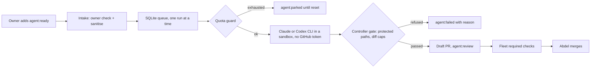

# agent-dispatcher

A serial, quota-aware dispatcher that turns issues Abdel labels into gated draft
PRs, using the official Claude Code and Codex CLIs within their terms.

It's the controller from the
[agent platform design](docs/design.md): GitHub Issues are the queue, labels are
the state machine, one AI run happens at a time, and the controller (not the agent)
decides whether a change is allowed to become a PR. Every PR then goes through the
fleet's normal required checks, and Abdel merges by hand.

## Status

Phase 1 skeleton (in progress). The controller will run in **dry-run only**: it polls, plans and gates,
but won't call a model or open a PR until the owner setup below is done.

| Piece | State |
|---|---|
| Label state machine and SQLite run queue with a single-run lock | planned |
| Owner-only intake and issue-text sanitiser | planned |
| Provider adapters: `claude -p`, `codex exec`, MiMo and NVIDIA (OpenAI-compatible) | planned |
| Quota guard (weekly share and reset times) | planned |
| Protected-path and diff-size gate | planned |
| GitHub App for draft PRs, Claude `setup-token`, Codex 0.162.1, NVIDIA key | owner setup pending |

## Install

Python 3.12 and [uv](https://docs.astral.sh/uv/).

```sh
uv sync --locked
cp .env.example .env   # then fill in values; never commit .env
```

## Usage

```sh
uv run agent-dispatcher once --dry-run   # one poll cycle, prints the plan
```

## How a task flows



## Credits

This code is independent, but the design borrows ideas from these open-source
projects. Thank you to their authors.

- [Cyrus](https://github.com/cyrusagents/cyrus): issue-to-agent sessions with
  per-issue worktrees.
- [OpenAI Symphony](https://github.com/openai/symphony): the poll, claim and
  reconcile loop over an issue tracker.
- [GitHub Agentic Workflows (gh-aw)](https://github.com/github/gh-aw): safe outputs,
  where the agent proposes and a separate step with write access publishes.
- [Codeman](https://github.com/Ark0N/Codeman): quota-aware scheduling of Claude Code
  sessions.

## Contributing

Changes go through pull requests with Conventional Commit titles. See the
[handbook](https://github.com/Abdel-Abdelaal/.github/tree/main/standards) and
[CONTRIBUTING](https://github.com/Abdel-Abdelaal/.github/blob/main/CONTRIBUTING.md).

## License

[MIT](LICENSE)
