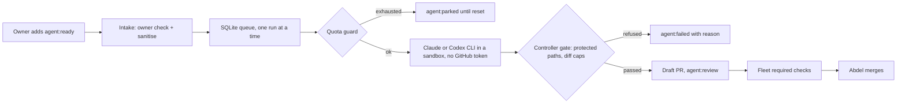

# agent-dispatcher

A serial, quota-aware dispatcher that turns issues Abdel labels into gated draft
PRs, using the official Claude Code and Codex CLIs within their terms.

It's the controller from the
[agent platform design](docs/design.md): GitHub Issues are the queue, labels are
the state machine, one AI run happens at a time, and the controller (not the agent)
decides whether a change is allowed to become a PR. Every PR then goes through the
fleet's normal required checks, and Abdel merges by hand.

## Status

Phase 3 routing on the laptop, which stands in for the VPS until the move. `once`
runs the next task with a team; `once --dry-run` only plans.

## Who does what

Claude and Codex are the strongest models with the smallest allowances, so they
only think: short, read-only plan and review steps. MiMo and NVIDIA have the
largest allowances, so they do the token-heavy implementation.

| Step | Role | Provider, in order of preference |
| --- | --- | --- |
| Triage | cheap screen; also rates the task easy, medium or hard | MiMo, else NVIDIA (chat API, JSON verdict) |
| Plan | thinker, read-only; re-rates the task on its first line | Claude, else Codex |
| Implement | worker | MiMo (Claude Code harness), else NVIDIA (OpenCode), else a thinker (Sonnet 5.5 / gpt-6.1-sol, medium) |
| Gate | controller | protected paths, diff size, test deletions, symlinks |
| Review | the other thinker, read-only | Codex if Claude planned, and the reverse |
| Repair | worker | one round on the reviewer's findings, then gate and review again |

### Thinking follows the task's difficulty

Conserving the thinkers' small allowances comes first, so the frontier models only
run on tasks that prove hard, and nothing goes above high effort.

| Level | Claude | Codex |
| --- | --- | --- |
| easy | `claude-sonnet-5-5`, low | `gpt-6.1-sol`, low |
| medium (also the default without triage) | `claude-sonnet-5-5`, medium | `gpt-6.1-sol`, medium |
| hard | `claude-opus-5-5`, high | `gpt-6-astra`, high |

The level can move during a run:

1. Triage sets the first level.
2. The planner rates the task on its first line. If it rates it harder than the
    level it planned at, it plans again at the new level. If it rates it easier, the
    review drops to the cheaper setting.
3. Each rejected review raises the level one step for the repair and the next
    review.

The level used is noted in the PR and in an `Agent-Level` commit trailer. The ladder
is the `DISPATCHER_THINKING_LADDER` setting (JSON), and the dispatcher passes every
model and effort explicitly, so changing the Codex app's `config.toml` doesn't
change the dispatcher.

A provider that reports its limit is parked until the time it gives (Codex prints
one) or for `DISPATCHER_PARK_HOURS`, and the next run forms a team without it.
Without any thinker the task waits. NVIDIA joins once `DISPATCHER_NVIDIA_API_KEY`
is set.

| Piece | State |
| --- | --- |
| Label state machine, SQLite queue, single-run lock, owner-only intake | built, tested |
| Live run: two clones, gate on the clean one, draft PR through `gh` | built, live-tested |
| Claude (plan, review) on its CLI login | built, live-tested |
| Codex (plan, review) on its ChatGPT login | built, tested with fakes |
| MiMo (triage, implement) through Claude Code | built, harness live-tested |
| NVIDIA (implement) through OpenCode | built; harness live-tested on MiMo's OpenAI API, needs a key |
| GitHub App for PRs | waits for the VPS move; the laptop uses the owner's `gh` login |

### CI repair

When no task is waiting, a cycle looks at open agent PRs (branches named
`agent/<issue>-run-<id>`). If every check has finished and a blocking one failed,
the worker gets the tail of each failing job's log (up to three jobs) for one
repair. The fix goes through the same gate on a clean clone of the PR branch and a
read-only review by a thinker, then is pushed to that branch, and the result is
commented on the PR. Advisory checks (`review / ai`) never trigger a repair. A PR is
repaired at most once: if that doesn't fix it, a human should look.

### Driving it from Claude

`skills/agent-dispatcher/SKILL.md` is an [Agent Skill](https://docs.claude.com/en/docs/claude-code/skills)
that teaches any Claude Code session to file tasks, read `agent-dispatcher status`
and the run log, explain failures and change models or repositories safely.
Install it by copying the folder to `~/.claude/skills/`.

## Install

Python 3.12 and [uv](https://docs.astral.sh/uv/).

```sh
uv sync --locked
cp .env.example .env   # then fill in values; never commit .env
```

## Usage

```sh
uv run agent-dispatcher once --dry-run   # one poll cycle, prints the plan
uv run agent-dispatcher once             # also runs the next task
uv run agent-dispatcher status           # waiting tasks, parked models, recent runs
```

Issues count only if the `agent:ready` label was added by `DISPATCHER_OWNER`.
The queue lives in `DISPATCHER_DB_PATH`; see `.env.example` for every setting.

A live run:

1. Labels the issue `agent:running`.
2. Clones the repository twice under `DISPATCHER_WORK_ROOT`.
3. Runs the provider in the first clone with the issue as untrusted data.
4. Applies only the resulting diff to the second, clean clone and gates it there.
5. Pushes from the clean clone with Git hooks disabled, opens a draft PR and
    labels the issue `agent:review`.

A refused or failed run gets `agent:failed` and a comment with the reason. An
exhausted provider gets `agent:parked` and is retried after `DISPATCHER_PARK_HOURS`.

The agent never pushes or holds a GitHub token. It can write anything in its own
clone, `.git/hooks` and `.git/config` included, so nothing is pushed from there.
Claude runs with `--setting-sources local`. That ignores user settings (which may
point Claude Code at another provider) and the repository's own
`.claude/settings.json`, whose hooks would otherwise run. Until the agent runs in
a sandbox it gets no Bash: it edits files, and CI runs the tests.

## Validate

```sh
uv run ruff format --check .
uv run ruff check .
uv run pyright
uv run pytest --cov --cov-branch
uv run lint-imports && uv run deptry . && uv run vulture
```

The import contract keeps the decision rules (`states`, `intake`, `gate`, `quota`)
free of network, subprocess and database code, so they're tested as pure functions.
The lockfile never resolves a release younger than 14 days (`exclude-newer`).

## How a task flows



## Credits

This code is independent, but the design borrows ideas from these open-source
projects. Thank you to their authors.

- [Cyrus](https://github.com/cyrusagents/cyrus): issue-to-agent sessions with
  per-issue worktrees.
- [OpenAI Symphony](https://github.com/openai/symphony): the poll, claim and
  reconcile loop over an issue tracker.
- [GitHub Agentic Workflows (gh-aw)](https://github.com/github/gh-aw): safe outputs,
  where the agent proposes and a separate step with write access publishes.
- [Codeman](https://github.com/Ark0N/Codeman): quota-aware scheduling of Claude Code
  sessions.

It runs this open-source tool, unmodified, as a separate process:

- [OpenCode](https://github.com/anomalyco/opencode) (MIT): the harness for MiMo and
  NVIDIA runs, through `opencode run` with API keys only.

Why these and not others is in
[ADR 0001](docs/decisions/0001-build-vs-adopt.md).

## Contributing

Changes go through pull requests with Conventional Commit titles. See the
[handbook](https://github.com/Abdel-Abdelaal/.github/tree/main/standards) and
[CONTRIBUTING](https://github.com/Abdel-Abdelaal/.github/blob/main/CONTRIBUTING.md).

## License

[MIT](LICENSE)
